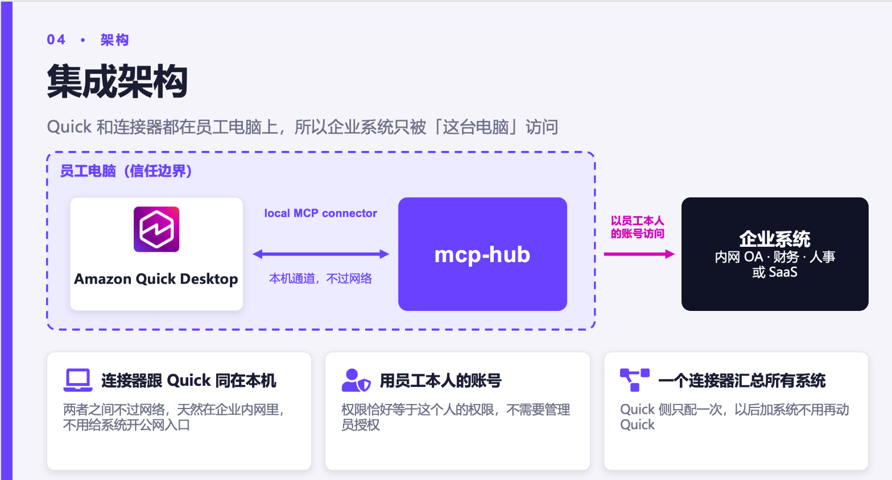

# mcp-hub

<!-- ALL-CONTRIBUTORS-BADGE:START - Do not remove or modify this section -->

<!-- ALL-CONTRIBUTORS-BADGE:END -->

**把企业现有系统接入 [Amazon Quick](https://aws.amazon.com/cn/quick/desktop/)，以员工本人的身份访问。**

**无需在企业侧做集成开发，也无需额外开通网络访问** —— 接入在员工自己的电脑上完成，
走的是员工本来就有的网络和账号。

安装后在配置页面填一次账号，Quick 即可使用这些系统：公司邮箱、金蝶云之家、飞书、百度网盘、QQ、GitHub、Jira。

单个可执行文件，无运行时依赖（不需要 Node 或 Python）；双击即打开配置页面。
**Windows、macOS、Linux 均提供发布包**，Windows 另有安装包。
Claude Desktop、Cursor、Cline、Kiro 这类读 MCP 配置的客户端同样可用。

---

## 集成架构

| 设计 | 结果 |
|---|---|
| 连接器与 Quick 同在员工电脑 | 两者走本机通道，不经网络；无需为内网系统开放公网入口 |
| 以员工本人的账号访问 | 权限与本人一致，无需管理员授权 |
| 无需在企业侧新建应用 | 飞书这类必须有应用的平台，由程序扫码代为创建 |
| 一个连接器汇总所有系统 | Quick 侧只配置一次，新增系统不再改动 Quick |
| 凭据只存本机 | 交由操作系统的凭据服务保管，见下节 |

员工本可手工把邮件内容粘贴进 Quick，本程序省去这一步，**不新增数据外发路径**。

---

## 支持的渠道

| 渠道 | 接入方式 | 只读 | 需开写开关 |
|---|---|---|---|
| 金蝶云之家 | 扫码授权 | 11 项（消息、审批、日程、通讯录） | 同意审批、发群消息、发私聊 |
| 飞书（国内版） | 扫码建应用 + 扫码授权 | 18 项（消息、日程、任务、文档、多维表格） | 10 项（发消息、建日程、建任务、改记录……） |
| 百度网盘 | 浏览器授权 + 粘回一个地址 | 5 项（身份、容量、列目录、搜文件名、文件详情） | 新建文件夹、重命名、移动、复制、删除 |
| 百度网盘分享链接（只读） | 分享链接 + 提取码，无需账号 | 1 项（逐级浏览分享中的文件和目录） | 无写工具 |
| 企业邮箱 | 邮箱地址 + 密码 | 3 项（最近邮件、搜索、读正文） | 发送邮件 |
| QQ 邮箱 | 邮箱地址 + 授权码 | 同上 | 发送邮件 |
| QQ（本机 NapCat） | 自动配置 | 5 项（群、好友、聊天记录） | 发群消息、发私聊 |
| GitHub | 授权登录或个人令牌 | 5 项（仓库、Issue、搜索） | 新建 Issue |
| Jira Cloud | 站点 + 邮箱 + API Token | 8 项（项目、JQL、详情、评论） | 建/改/指派/流转/评论 |
| 本机邮件（macOS / Windows） | 勾选来源，无需密码 | 3 项（文件夹、搜索、读正文）；Mac：Apple Mail / 旧版 Outlook / 新版 Outlook；Windows：经典 Outlook / 新版 Outlook | 无写工具 |
| 飞书文档（只读 + 浏览器扩展，预览） | 装扩展 + 配对码，借浏览器里已登录的飞书网页版 | 3 项（读文档、最近文档、检索） | 无，这个渠道没有写操作 |

新增渠道只需增加一份渠道声明，不改程序。

**本机邮件**直接读这台电脑上邮件 App 的本地数据，不连邮件服务器、不需要密码，
也不会改动任何邮件文件。默认关闭，在配置页添加「本机邮件（只读）」并勾选来源后才注册工具
（`localmail_list_folders` / `localmail_search` / `localmail_get`，用 `source` 参数选
`apple_mail`、`outlook_legacy` 或 `outlook`（新版 Outlook）；Windows 上是 `outlook_classic_win`（经典 Outlook）和 `outlook_new_win`（新版 Outlook）。新版 Outlook 读不出已读状态和附件，部分文件夹名和收件人可能缺失，结果里用 `incomplete` 标出；Outlook 升级导致格式不认识时这个来源自动停用并提示，不影响其他来源）。读 Apple Mail 需要给 **Amazon Quick** 授「完全磁盘访问权限」
（系统设置 → 隐私与安全性 → 完全磁盘访问权限），授权后完全退出并重开 Amazon Quick；
没授权时工具返回这段指引，服务和其他来源照常可用。正文长度上限（默认 32 KB）和每页条数上限（默认 50）
可在「高级设置」里改。

---

## 开始用

安装包无需管理员权限。双击 → 在「内置渠道」里选渠道 → 扫码或填账号 →
「测试并保存」→ 把右侧那段配置粘入 [Amazon Quick Desktop](https://aws.amazon.com/cn/quick/desktop/)。

下载地址与详细步骤见 [`docs/使用说明.md`](docs/使用说明.md)，
[Word 版](docs/MCP-Hub-使用说明.docx)可直接提供给客户。

---

## 凭据怎么保存

- **密码只交给操作系统** —— Windows 凭据管理器、macOS 钥匙串、Linux Secret Service。
  不进配置文件、不进日志、不上传。
- **模型拿不到密码** —— 只能让程序以使用者本人的身份执行操作。
- **配置文件不含凭据** —— 仅记录渠道、账号、服务器地址与开关状态，可直接用于排查。
- **卸载不清除密码** —— 需在系统凭据管理器中删除 `mcp-hub` 开头的条目。
- **无遥测、无数据回传、无服务端。**
- **不代为下载第三方程序** —— QQ 渠道依赖的 NapCat 由使用者自行安装。
- **飞书文档浏览器扩展不碰登录态** —— 扩展只读页面里已经加载的文档内容，不读 cookie、
  不调飞书内部接口；文档所有者禁止了复制或导出的一律不读，没有强制读取的开关。
  见 [`docs/飞书网页文档.md`](docs/飞书网页文档.md)。

**写操作默认关闭。** 发邮件、同意审批、发消息等不可逆动作默认不提供给模型，
需逐个渠道、逐个账号手动开启。未开启的功能模型不可见。

---

## 适用范围

按个人身份与单机配置设计：每台电脑各自配置、各自授权，不提供集中授权、
统一策略与统一审计，也没有管理端。

---

## 合作模式

开分支或 Fork → 提 PR 到 `main` → 三平台测试通过后由维护者合并。

新增渠道的 PR 需写明哪些操作属于写操作，并附一个真实账号跑通的记录 ——
写操作标注错误将导致不可逆动作被默认开放给模型。

使用者能感觉到的改动，在 [`CHANGELOG.md`](CHANGELOG.md) 的「未发布」下加一行。发布时 CI 把这个版本那一节
放到 Release 页面上，找不到就不发布。

`main` 已启用分支保护：必须经 PR 合并、CI 必须通过、禁止 force push。

---

## 贡献与致谢

**百盈云创** —— 贡献了**飞书渠道**（[PR #27](https://github.com/nimysan/quick-mcp-hub/pull/27)）。
百盈集团旗下数字科技企业，AWS 亚马逊云科技 GSPP 全球解决方案提供商、
大湾区亚马逊云科技行业数字化赋能中心（简称：大湾区 IDAC）运营单位，
聚焦企业上云与全球化出海服务。

### Contributors ✨

<!-- ALL-CONTRIBUTORS-LIST:START - Do not remove or modify this section -->
<!-- prettier-ignore-start -->
<!-- markdownlint-disable -->
<table>
  <tbody>
    <tr>
      <td align="center" valign="top" width="14.28%"><a href="https://github.com/nimysan"> <b>Sean Ye</b></a> <a href="https://github.com/nimysan/quick-mcp-hub/commits?author=nimysan" title="Code">💻</a> <a href="https://github.com/nimysan/quick-mcp-hub/commits?author=nimysan" title="Documentation">📖</a> <a href="#infra-nimysan" title="Infrastructure (Hosting, Build-Tools, etc)">🚇</a></td>
      <td align="center" valign="top" width="14.28%"><a href="https://github.com/Jeremyforwork"> <b>Jeremy Zhong</b></a> <a href="https://github.com/nimysan/quick-mcp-hub/commits?author=Jeremyforwork" title="Code">💻</a></td>
      <td align="center" valign="top" width="14.28%"><a href="https://github.com/liangyimingcom"> <b>liangyimingcom</b></a> <a href="https://github.com/nimysan/quick-mcp-hub/commits?author=liangyimingcom" title="Code">💻</a></td>
      <td align="center" valign="top" width="14.28%"><a href="https://github.com/Wyifei"> <b>Wyifei</b></a> <a href="https://github.com/nimysan/quick-mcp-hub/commits?author=Wyifei" title="Code">💻</a></td>
    </tr>
  </tbody>
</table>

<!-- markdownlint-restore -->
<!-- prettier-ignore-end -->

<!-- ALL-CONTRIBUTORS-LIST:END -->

加贡献者：在任意 issue 或 PR 中评论 `@all-contributors please add @用户名 for code`
（[图标含义](https://allcontributors.org/docs/en/emoji-key)）。

---

## 许可与免责

本项目依据 **Apache License, Version 2.0** 发布，全文见 [`LICENSE`](LICENSE)。

> 本软件按「**现状**」（AS IS）提供，不附带任何形式的明示或默示担保，包括但不
> 限于对适销性、特定用途适用性及不侵权的担保。在任何情况下，版权持有人及贡献
> 者均不对因使用本软件而产生的任何索赔、损害或其他责任承担义务。
>
> 完整条款见 LICENSE 第 7 条（Disclaimer of Warranty）与第 8 条
> （Limitation of Liability）。

使用者自行承担的部分：

- **账号与数据属于使用者自己。** 本软件以使用者本人的身份访问其自行配置的系统，
  由此产生的一切操作与后果（含误发邮件、误批单据、误发消息）由使用者负责。
- **写开关一旦开启，模型即可执行不可逆动作**，是否开启由使用者决定。
- **第三方系统的接口、条款与可用性不受本项目控制**，随时可能变化。
- **使用第三方系统须遵守其各自的服务条款。** QQ 渠道依赖的 NapCat 使用非官方协议，
  账号风险落在使用者登录的那个 QQ 号上；该组件不由本项目提供。
- **本软件未做代码签名**，首次运行会被 Windows SmartScreen 或 macOS Gatekeeper 拦下。

第三方组件的许可与归属声明见 [`THIRD-PARTY-NOTICES.md`](THIRD-PARTY-NOTICES.md)
和 [`NOTICE`](NOTICE)。所有依赖均为宽松型许可，不含传染性条款。

---

## 文档

| 看什么 | 去哪 |
|---|---|
| 每个版本改了什么 | [`CHANGELOG.md`](CHANGELOG.md) |
| 下载、安装、配置、接入 Quick | [`docs/使用说明.md`](docs/使用说明.md) · [Word 版](docs/MCP-Hub-使用说明.docx) |
| 本机邮件（只读）：来源、限制、安全设计、测试方法 | [`docs/localmail.md`](docs/localmail.md) |
| 发布包中提供给客户的版本 | [`packaging/快速开始.md`](packaging/快速开始.md) |
| 从源码构建并本地运行（含 Windows PowerShell 命令） | [`docs/本地运行快速启动.md`](docs/本地运行快速启动.md) |
| 构建方式与实现取舍 | [`docs/实现笔记.md`](docs/实现笔记.md) |
| 第三方开源组件清单 | [`THIRD-PARTY-NOTICES.md`](THIRD-PARTY-NOTICES.md) |
