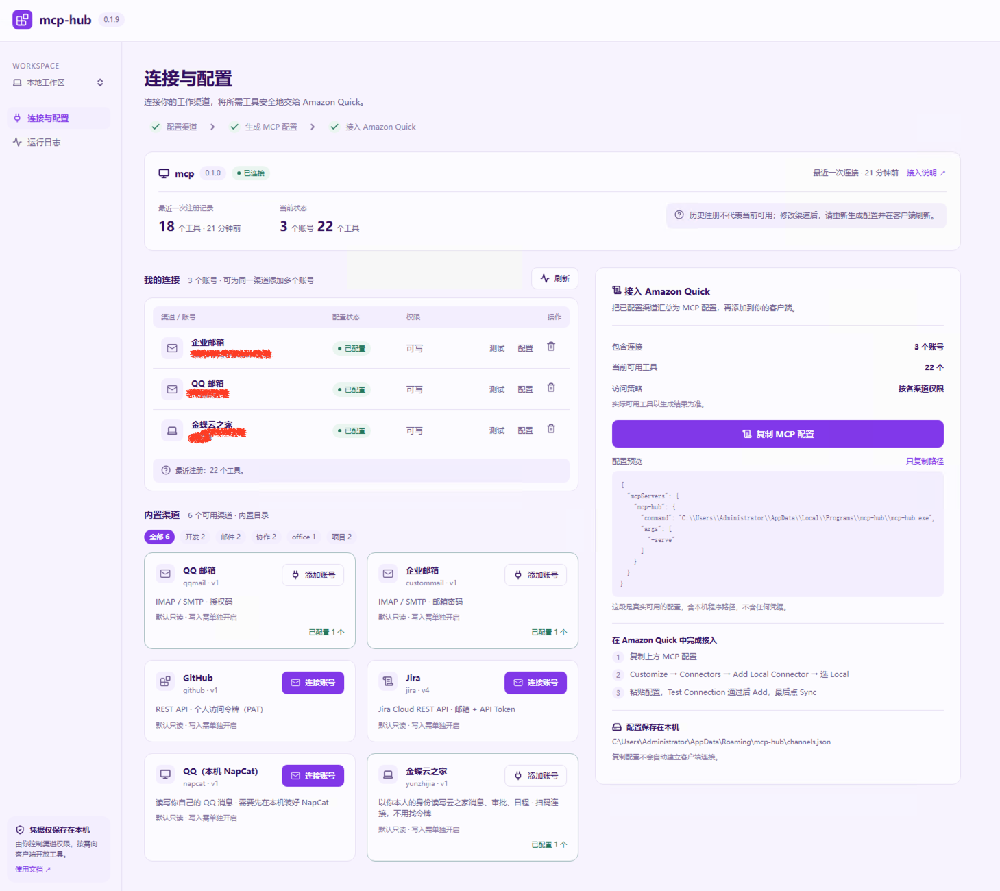

# mcp-hub

<!-- ALL-CONTRIBUTORS-BADGE:START - Do not remove or modify this section -->

<!-- ALL-CONTRIBUTORS-BADGE:END -->

**让 Amazon Quick 用上企业现有系统，不需要先做一个整合项目。**

装一个程序，在页面上填一次账号，Quick 里就多出一批能用的功能：读写公司邮箱、
读写金蝶云之家的消息和审批、读写飞书的消息与日程任务文档、读写 QQ、查 GitHub 和 Jira。

使用者是公司里的财务和运营，不是程序员。所以目标机**不需要 Node、不需要
Python、不需要任何运行时** —— 整个程序就是一个可执行文件，双击打开的就是
配置页面，没有命令行、不用手工编辑配置。

Claude Desktop、Cursor、Cline、Kiro 这类读 MCP 配置的客户端同样能用。

---

## 它解决什么问题

Quick 能回答问题、能办事，前提是看得到企业的数据。标准路径是做一个系统对接项目：
IT 立项 → 注册应用 → 开放网络 → 安全评审。而国内的 HR、财务、OA 多为私有化部署，
接口不标准，业务部门自己推不动 —— 有需求的是财务和运营，能拍板的是 IT，中间卡住。

mcp-hub 换一个接入位置：不改企业系统，不改 Quick，把连接点放到员工自己的电脑上。

- **不需要 IT 立项**
- **不需要注册应用**（飞书那类必须有应用的，扫码代办）
- **不需要给内网系统开公网入口**
- **不需要把密码交给云端**

用起来就是直接问 Quick：「我有哪些审批待办？」「我那张请款单批到哪一步了？」
「搜一下财务上周发的邮件。」

---

## 集成架构

| 设计 | 带来什么 |
|---|---|
| 连接器跟 Quick 同在本机 | 两者之间不过网络，天然在企业内网里，不用给系统开公网入口 |
| 用员工本人的账号 | 权限恰好等于这个人的权限，不多不少，不需要管理员授权 |
| 一个连接器汇总所有系统 | Quick 侧只配一次，以后加系统不用再动 Quick |

数据流向和合规边界与原来一致：员工本来就能把邮件内容复制粘贴进 Quick，
mcp-hub 省掉的是复制粘贴这一步，**没有新增数据外发面**。

---

## 支持的渠道

| 渠道 | 接入方式 | 只读 | 需开写开关 |
|---|---|---|---|
| 金蝶云之家 | 扫码授权 | 11 项（消息、审批、日程、通讯录） | 同意审批、发群消息、发私聊 |
| 飞书（国内版） | 扫码自动建应用 + 扫码授权 | 18 项（消息、日程与忙闲、任务、搜文档读文档、多维表格） | 10 项（发消息、回复、建日程、邀请参会人、建任务、改多维表格记录……） |
| 企业邮箱 | 邮箱地址 + 密码 | 3 项（最近邮件、搜索、读正文） | 发送邮件 |
| QQ 邮箱 | 邮箱地址 + 授权码 | 同上 | 发送邮件 |
| QQ（本机 NapCat） | 自动配置 | 5 项（群、好友、聊天记录） | 发群消息、发私聊 |
| GitHub | 授权登录或个人令牌 | 5 项（仓库、Issue、搜索） | 新建 Issue |
| Jira Cloud | 站点 + 邮箱 + API Token | 8 项（项目、JQL、详情、评论） | 建/改/指派/流转/评论 |

**新增一个渠道不需要改程序** —— 所以一线交付在客户现场遇到哪套系统，就可以把它
做成一个渠道合进主干，所有客户一起共享。

---

## 开始用

一个安装包，不需要管理员权限。双击打开的就是配置页面：在「内置渠道」里点要用的
渠道，按提示扫码或填账号，点「测试并保存」，再把右侧那段配置粘进 Quick。

**下载地址、安装、逐个渠道怎么配、怎么接到 Amazon Quick、常见问题** 全部在
[`docs/使用说明.md`](docs/使用说明.md)，同内容的 Word 在
[`docs/MCP-Hub-使用说明.docx`](docs/MCP-Hub-使用说明.docx)（可以直接发给客户）。

---

## 凭据怎么保存

这一节是本项目的核心承诺。

**密码只交给操作系统保管** —— Windows 的凭据管理器、macOS 的钥匙串、Linux 的
Secret Service。不写进配置文件、不写进日志、不上传。

**AI 拿不到密码。** 程序内部没有任何把凭据交给模型的路径 —— 模型只能让程序以
使用者本人的身份去办事。

**配置文件里没有秘密。** 程序在磁盘上记的只有「配了哪个渠道、哪个账号、服务器
地址、开关开没开」，可以直接查看、备份、发给维护者排查问题。

**卸载不会删掉密码** —— 密码由操作系统保管，和程序是分开的。要彻底清除，在系统的
凭据管理器或钥匙串里删掉 `mcp-hub` 开头的条目。

### 不做什么

- **没有遥测、没有数据回传。** 程序只连接使用者自己配置的那些系统。
- **不代为下载第三方程序。** QQ 渠道依赖的 NapCat 由使用者自行获取安装。
- **不内置任何账号、密钥或服务端。** 发布包里没有凭据，也没有我方服务器。

### 写操作默认关闭

发邮件、同意审批、发消息、建 Issue 这类**不可逆动作**，默认**不交给模型** ——
必须使用者在页面上逐个渠道、逐个账号手动打开开关。关着的功能模型看不到，
因此不可能被诱导调用。

---

## 适用边界

适合：业务部门先试点、没有整合预算、系统在内网、一人一机各用自己的账号。

不适合：需要集中授权、统一策略和统一审计的场景 —— 它是个人身份视角的工具，
每台电脑各自配置、各自授权，没有管理端。

---

## 合作模式

外部合作者**不直接推主干**，一律走 PR：

1. Fork，或在本仓库开一个分支（`feat/渠道名`、`fix/xxx`）
2. 提 PR 到 `main`，写清改了什么、怎么验证的
3. 等三平台测试通过，由维护者评审合并 —— 合作者自己不合自己的 PR

新增渠道的 PR 请在描述里附上：这个渠道能做哪些事、哪些算写操作（需要开关）、
以及用一个真实账号跑通的证据。渠道声明里把写操作标错，等于默认把不可逆动作
交给模型 —— 这是评审时最先看的一条。

`main` 已开启分支保护：必须通过 PR 合并、三平台测试通过，禁止 force push 和删除分支。
评审不是硬性门槛，但 [`.github/CODEOWNERS`](.github/CODEOWNERS) 会把每个 PR 自动指给维护者。

---

## 贡献与致谢

感谢以下参与方对本项目的贡献：

**百盈云创** —— 贡献了**飞书渠道**（[PR #27](https://github.com/nimysan/quick-mcp-hub/pull/27)：
以用户本人身份读写消息、日程、任务、云文档和多维表格，扫码一键建应用）。
百盈集团旗下数字科技企业，AWS 亚马逊云科技 GSPP 全球解决方案提供商、
大湾区亚马逊云科技行业数字化赋能中心（简称：大湾区 IDAC）运营单位，
聚焦企业上云与全球化出海服务。

### Contributors ✨

本项目遵循 [all-contributors](https://github.com/all-contributors/all-contributors)
规范，表格由工具生成（图标含义见 [emoji 对照表](https://allcontributors.org/docs/en/emoji-key)）：

<!-- ALL-CONTRIBUTORS-LIST:START - Do not remove or modify this section -->
<!-- prettier-ignore-start -->
<!-- markdownlint-disable -->
<table>
  <tbody>
    <tr>
      <td align="center" valign="top" width="14.28%"><a href="https://github.com/nimysan"> <b>Sean Ye</b></a> <a href="https://github.com/nimysan/quick-mcp-hub/commits?author=nimysan" title="Code">💻</a> <a href="https://github.com/nimysan/quick-mcp-hub/commits?author=nimysan" title="Documentation">📖</a> <a href="#infra-nimysan" title="Infrastructure (Hosting, Build-Tools, etc)">🚇</a></td>
      <td align="center" valign="top" width="14.28%"><a href="https://github.com/Jeremyforwork"> <b>Jeremy Zhong</b></a> <a href="https://github.com/nimysan/quick-mcp-hub/commits?author=Jeremyforwork" title="Code">💻</a></td>
    </tr>
  </tbody>
</table>

<!-- markdownlint-restore -->
<!-- prettier-ignore-end -->

<!-- ALL-CONTRIBUTORS-LIST:END -->

要记一位新的贡献者，在任意 issue 或 PR 里评论
`@all-contributors please add @用户名 for code, doc`，机器人会开 PR 更新这张表；
也可以本地跑 `npx all-contributors-cli add 用户名 code,doc`。

---

## 许可与免责

本项目依据 **Apache License, Version 2.0** 发布，全文见 [`LICENSE`](LICENSE)。

> 本软件按「**现状**」（AS IS）提供，不附带任何形式的明示或默示担保，包括但不
> 限于对适销性、特定用途适用性及不侵权的担保。在任何情况下，版权持有人及贡献
> 者均不对因使用本软件而产生的任何索赔、损害或其他责任承担义务。
>
> 完整条款见 LICENSE 第 7 条（Disclaimer of Warranty）与第 8 条
> （Limitation of Liability）。

使用者需要知道并自行承担的部分：

- **账号与数据属于使用者自己。** 本软件以使用者本人的身份访问其自行配置的系统，
  由此产生的一切操作与后果（包括误发邮件、误批单据、误发消息）由使用者负责。
- **写开关一旦打开，模型即可执行不可逆动作。** 是否打开由使用者决定。
- **第三方系统的接口、条款和可用性不受本项目控制**，随时可能变化。
- **使用第三方系统须遵守其各自的服务条款。** 特别是 QQ 渠道依赖的 NapCat 使用
  非官方协议，账号风险落在使用者登录的那个 QQ 号上；该组件不由本项目提供。
- **本软件未做代码签名**，首次运行会被 Windows SmartScreen 或 macOS Gatekeeper
  拦下，这是预期行为。

第三方组件的许可与归属声明见 [`THIRD-PARTY-NOTICES.md`](THIRD-PARTY-NOTICES.md)
和 [`NOTICE`](NOTICE)。所有依赖均为宽松型许可，不含传染性条款。

---

## 文档

| 看什么 | 去哪 |
|---|---|
| 怎么下载、安装、配置、接到 Quick（含下载地址） | [`docs/使用说明.md`](docs/使用说明.md) · 同内容的 Word：[`MCP-Hub-使用说明.docx`](docs/MCP-Hub-使用说明.docx) |
| 发布包里给客户的那份 | [`packaging/快速开始.md`](packaging/快速开始.md) |
| 怎么构建、为什么这样实现（贡献者看） | [`docs/实现笔记.md`](docs/实现笔记.md) |
| 第三方开源组件清单 | [`THIRD-PARTY-NOTICES.md`](THIRD-PARTY-NOTICES.md) |
