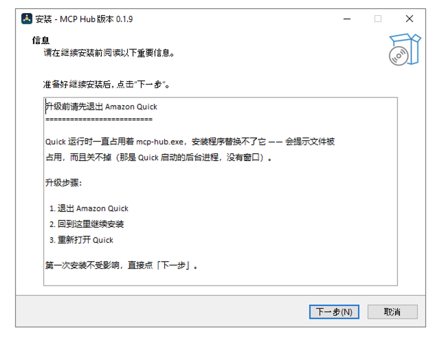
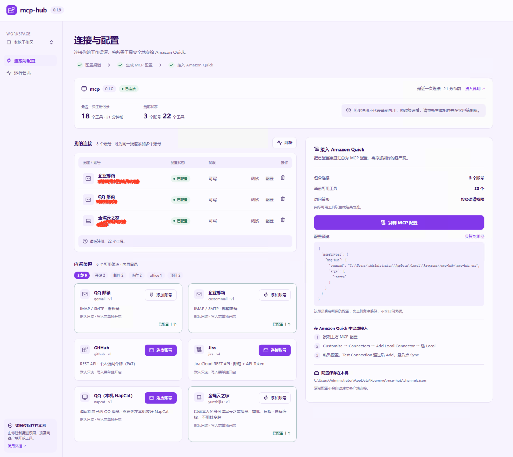
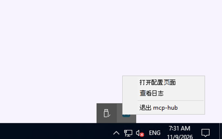
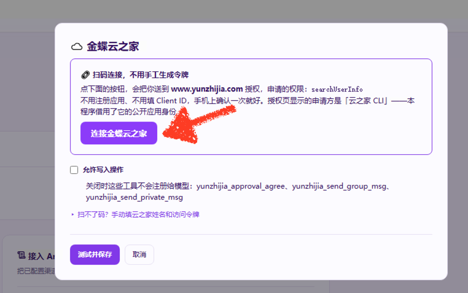
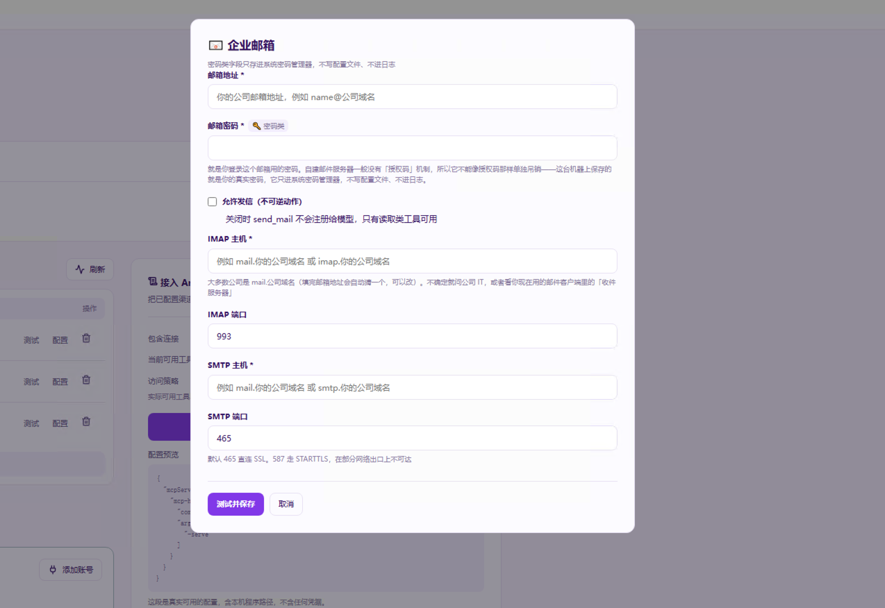
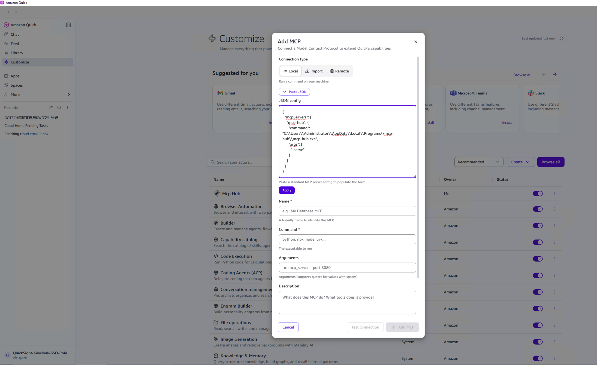
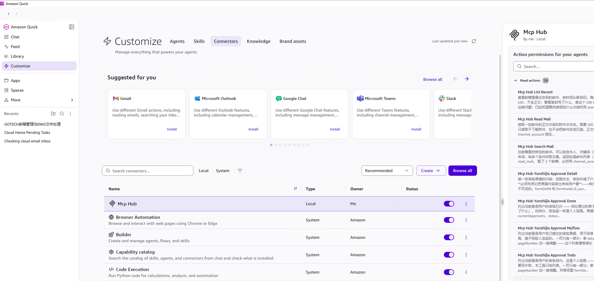

# MCP Hub 使用说明

---

## 这个工具能帮你做什么

装上 MCP Hub 之后，**Amazon Quick 就能直接读写你的云之家、飞书、公司邮箱和 QQ**。
你在 MCP Hub 里填一次账号，之后就在 Quick 里用大白话提问就行：

- 「我有哪些审批待办？」
- 「我那张请款单批到哪一步了？」
- 「技术交流群今天聊了什么？」
- 「飞书上搜一下谁提过客户报价」
- 「我明天有哪些会？」
- 「搜一下财务上周发给我的邮件，内容念给我听」
- 「帮我看下周三有什么日程」

MCP Hub 是**你自己电脑上的一个小程序**。它不需要装 Python、Node 或任何别的
东西，整个程序就是一个文件。你的账号密码只存在这台电脑里。

目前支持：**金蝶云之家** · **飞书** · **企业邮箱** · QQ 邮箱 · QQ · GitHub · Jira

---

## 第一步：下载

去 Releases 页面，下载最新一版：

[https://github.com/nimysan/quick-mcp-hub/releases/latest](https://github.com/nimysan/quick-mcp-hub/releases/latest)

页面下方的 Assets 里按自己的电脑选一个文件：

| 你的电脑 | 下载这个 |
|---|---|
| Windows —— 绝大多数人用这个 | `mcp-hub-*-windows-amd64-setup.exe`（安装包） |
| Windows，不想装 | `mcp-hub-*-windows-amd64.zip`（解压即用） |
| Windows ARM，Surface / 骁龙笔记本 | `mcp-hub-*-windows-arm64.zip` |
| Mac，M1 / M2 / M3 / M4 芯片 | `mcp-hub-*-darwin-arm64.zip` |
| Mac，Intel 芯片 | `mcp-hub-*-darwin-amd64.zip` |
| Linux | `mcp-hub-*-linux-amd64.zip` |

> 不确定选哪个，就用第一个。文件名里的 `*` 是版本号。

---

## 第二步：安装

双击安装包，一路「下一步」，装完勾上「立即运行」。
以后从**开始菜单**里的 MCP Hub 进。**不需要管理员权限。**

安装过程中会有一页提示，说的就是下面这件事：



> **如果你之前装过、现在是升级：请先退出 Amazon Quick，再装。**
> Quick 运行的时候一直占用着 `mcp-hub.exe`，安装程序替换不了它，会提示文件
> 被占用，而且那个占用的进程是 Quick 在后台启动的、没有窗口，你关不掉。
> 顺序是：退出 Quick → 继续安装 → 重新打开 Quick。
> **第一次安装不受影响**，直接点下一步。

第一次运行 Windows 可能会弹「已保护你的电脑」（因为这个程序还没买代码签名
证书）—— 点 **更多信息**，再点 **仍要运行**。

Mac 和 Linux 是解压即用，双击 `mcp-hub` 就行。
Mac 第一次会被系统拦下来，在「终端」里对解压出来的文件夹执行一次：

```
xattr -dr com.apple.quarantine /你解压的路径/mcp-hub
```

---

## 第三步：打开配置页面

程序启动后会**自己弹出一个配置窗口**。
没弹出来的话，用浏览器打开 **http://127.0.0.1:7801** —— 是同一个页面。
这个页面只在你自己的电脑上，公司网络里别人访问不到。



页面顶部那条进度就是你要走的三步：

```
配置渠道  →  生成 MCP 配置  →  接入 Amazon Quick
```

**Windows 上不会有黑窗口。** 程序在屏幕右下角的托盘里（可能要点那个小箭头
才看得到）：

| 你的操作 | 会发生什么 |
|---|---|
| 点页面右上角的 ✕ | 只关掉页面，程序还在托盘里运行 |
| 左键点托盘图标 | 把配置页面叫回来 |
| 右键托盘图标 | 出菜单：打开配置页面 / 查看日志 / 退出 |
| 右键 → **退出 mcp-hub** | 真正退出，页面窗口也一起关掉 |



---

## 第四步：配置你要用的渠道

页面中间「内置渠道」里，点你要用的那个的「**添加账号**」或「**连接账号**」。

每个渠道填完都点「**测试并保存**」。程序会**真的连一次**，**连不上就不保存** ——
所以保存成功就代表能用，不会出现「存好了但用不了」。

同一个渠道可以加**多个账号**（比如两个邮箱），用的时候在 Quick 里说清是哪个。

下面按重要程度分别说。

---

### 金蝶云之家（扫码就行，不用找令牌）

**怎么配**

在「内置渠道」里找到「金蝶云之家」，点「**添加账号**」，然后点弹窗里那个
紫色的「**连接金蝶云之家**」按钮。



页面上会出现一个二维码。**用手机上的云之家 App 扫它**，在手机上点一次确认
就好了。


扫完回到电脑上，姓名会自动填好 —— 点「**测试并保存**」就配完了。

全程不用注册应用、不用找 AppKey 或 Client ID，扫码就完事。
授权之后 MCP Hub 是**以你本人的身份**读写云之家。

> **手机上的授权页会显示申请方是「云之家 CLI」，这是正常的** —— 本程序借用
> 了云之家官方命令行工具的公开应用身份，申请的权限只有 `searchUserInfo`。
> 扫不了码的话，弹窗里有「扫不了码？手动填云之家姓名和访问令牌」可以展开。

**配好之后能在 Quick 里问什么**

| 你问 Quick | 它会去做 |
|---|---|
| 「我有哪些审批待办？」 | 列出你的待办单据 |
| 「我那张请款单到哪一步了？」 | 查你自己发起的审批进度 |
| 「上周我批过哪些单子？」 | 查你的审批已办 |
| 「那张单子具体写了什么？」 | 读单据详情、各个字段的内容 |
| 「技术交流群今天聊了什么？」 | 读群聊历史消息 |
| 「我最近有哪些群和私聊？」 | 列出最近会话 |
| 「张三的部门和职位是什么？」 | 搜通讯录 |
| 「这个群里都有谁？」 | 列出群成员 |
| 「我下周三有什么日程？」 | 查日程 |

一共 11 项只读功能，上面是最常用的。

**这三件事默认是关着的**（因为做了就撤不回来）：

- **同意审批单据** —— 以你的名义真的批掉一张单子
- **发群消息** —— 以你的名义在群里说话
- **发私聊消息** —— 以你的名义给同事发私信

要用的话，在上面那个弹窗里勾上「**允许写入操作**」（就在连接按钮下面那一行）。
**不勾的话 Quick 根本看不到这几个功能**，不可能误操作。

---

### 飞书（扫两次码，不用找 IT）

只支持**飞书国内版**（feishu.cn），Lark 国际版暂不支持。

**怎么配**

在「内置渠道」里找到「飞书」，点「**添加账号**」，再点弹窗里紫色的
「**连接飞书**」按钮。接下来要用飞书确认两次：

1. **建应用**：点「打开飞书，创建应用」，在飞书里确认。这一步会在你的公司里
   建一个只给你自己用的应用，名字是「MCP Hub（你的名字）」。
2. **授权**：页面会自动换成第二步，点「打开飞书，确认授权」，在飞书里确认。

两步都确认完，页面显示「已连接为 某某某」，就配好了。App ID、App Secret、
令牌都由程序自己取、自己存，不用填任何东西。

> **公司要求管理员审批应用的话**，第一步之后会提示授权没能开始。等管理员
> 在飞书里批准这个应用，再回来点一次「连接飞书」就行 —— **不会重复建应用**。
>
> **公司已经由 IT 建好了应用？** 展开弹窗里的「已经有应用了？填 App ID 和
> App Secret」，把 IT 给的两项填进去再点连接，就会跳过建应用这一步。

授权之后 MCP Hub 是**以你本人的身份**读写飞书：你发出的消息，对方看到的
发送者是你，不是机器人。

**配好之后能在 Quick 里问什么**

| 你问 Quick | 它会去做 |
|---|---|
| 「我有哪些飞书群？」 | 列出你所在的群 |
| 「XX 群最近聊了什么？」 | 读群聊记录，带发送人和时间 |
| 「我和张三最近聊了什么？」 | 读私聊记录 |
| 「搜一下谁提过客户报价」 | 跨所有群和私聊搜消息 |
| 「那条消息下面大家怎么说的？」 | 读话题讨论 |
| 「帮我找一下张三」 | 按姓名搜同事 |
| 「我明天有哪些会？」 | 列出你的日程 |
| 「周三下午张三和李四什么时候都有空？」 | 查几个人的忙闲 |
| 「我还有哪些任务没做完？」 | 列出分配给你的任务 |
| 「找一下报销流程的文档，总结一下」 | 搜文档并读正文 |
| 「订单表里还有哪些没发货？」（附上多维表格链接） | 按条件查多维表格记录 |

一共 18 项只读功能。

**这些事默认是关着的**（做了就是以你的名义真的做了）：

- **消息**：发消息、回复消息
- **日程**：建日程、邀请参会人、接受或拒绝日程邀请
- **任务**：建任务并指派给同事、把任务标成完成、评论任务
- **多维表格**：新增一行、修改一行

要用的话，到「我的连接」里点飞书这一行的「**配置**」，勾上「**允许写入操作**」，
点「测试并保存」，然后按第六步让 Quick 重连。**不勾的话 Quick 根本看不到这些
功能。** 打开之后，Quick 动手前会先把要做的事给你确认。

> 多维表格要你把表格链接发给 Quick（浏览器地址栏里那一串）。文档只能读，
> 不能改；表格（sheet）目前读不了。

**要知道的一件事**：授权 **7 天内用过一次**就会自动续下去，不用管它。
**超过 7 天完全没用**的话授权会失效，到「我的连接」里点飞书这一行，
点「**重新授权**」，再用飞书确认一次就恢复了（不会重新建应用）。

---

### 企业邮箱（公司自己的邮箱）

**怎么配**

填四样东西：

| 填什么 | 说明 |
|---|---|
| 邮箱地址 | 你的完整公司邮箱，比如 `zhangsan@公司域名.com` |
| 邮箱密码 | 就是你登录这个邮箱用的密码 |
| IMAP 主机 / 端口 | 收邮件的服务器，端口一般是 **993** |
| SMTP 主机 / 端口 | 发邮件的服务器，端口一般是 **465** |



**填完邮箱地址之后，两个主机地址会自动猜好**（通常是 `mail.公司域名.com`）。
如果猜得不对、或者保存时提示连不上，**把这两个地址问一下公司 IT**，
他们一句话就能告诉你。也可以看你现在用的邮件客户端里的「收件服务器」。

点「测试并保存」之后会显示**三步检查**，失败时能看出是哪一步坏的：

```
① IMAP 可达    —— 收件服务器连得上吗
② 账号密码     —— 用户名密码对不对
③ SMTP 可达    —— 发件服务器连得上吗
```

如果第 ② 步报密码不对，但你确认密码没错，**试试把登录名里的 `@公司域名.com`
去掉**，只填前面那一段 —— 有些公司的邮件服务器要的是这种短用户名。

**配好之后能在 Quick 里问什么**

| 你问 Quick | 它会去做 |
|---|---|
| 「我最近收到哪些邮件？」 | 列出最近的邮件 |
| 「搜一下财务上周发的邮件」 | 按关键词搜邮件 |
| 「那封邮件写了什么？念给我听」 | 读邮件正文 |
| 「帮我回一封邮件给他」 | **发邮件（默认关闭）** |

**发邮件默认是关着的。** 要用就在表单里勾上「允许发信」。

---

### QQ 邮箱

和企业邮箱几乎一样，只有一个关键区别：**密码那一栏要填 16 位授权码，
不是你的 QQ 登录密码。**

怎么拿授权码：

```
QQ 邮箱网页版 → 设置 → 账号与安全 → 安全设置
  → 开启服务（会给你手机发一条短信）
  → 生成授权码   （16 位小写字母）
```

IMAP / SMTP 主机已经预填好了，不用管。
能问的问题和企业邮箱完全一样。

---

### QQ（需要先装 NapCat）

这个渠道让 Quick 能读你的 QQ 群消息和好友消息。
**前提是这台电脑上已经装好并登录了 NapCat**（一个 QQ 机器人框架）。

配的时候别自己填 —— 表单顶部有个「**⚡ 自动配置**」按钮，
点一下它会替你开好接口、生成令牌、把三个字段都填上。

**能问什么**：我有哪些群 / 有哪些好友 / 某个群最近聊了什么 / 和某人的私聊记录。

**发群消息、发私聊消息默认关着** —— 和云之家同理，发出去撤不回。

---

### GitHub 和 Jira

给研发用的：

- **GitHub** —— 点「连接账号」授权，或者自己填用户名 + 个人访问令牌
- **Jira** —— 填站点地址 + 邮箱 + API Token

GitHub 能查仓库和 Issue（新建 Issue 要开开关）；
Jira 能查项目、搜工单、读详情和评论（新建、改状态、指派、评论要开开关）。

---

## 第五步：接到 Amazon Quick

### 先在 MCP Hub 里复制配置

配置页面**右边**那一栏「接入 Amazon Quick」里，点那个紫色的
「**复制 MCP 配置**」按钮。它复制出来的是一段这样的东西，里面已经带好了
**你这台电脑上的真实路径**：

```
{
  "mcpServers": {
    "mcp-hub": {
      "command": "C:\\Users\\你的用户名\\AppData\\Local\\Programs\\mcp-hub\\mcp-hub.exe",
      "args": ["-serve"]
    }
  }
}
```

> 路径一定**从页面上复制，不要手打**。页面给的是正在运行的那个程序的真实
> 路径，所以不管你装在哪、后来挪到哪，复制过去都是对的。
> 这段配置里**不含任何密码**。

### 再到 Quick 里粘进去

在 Amazon Quick 里：

```
左边栏 Customize  →  上面选 Connectors  →  右边点 Create  →  Add MCP
```

弹出的窗口里：

1. **Connection type** 选 **Local**
2. 点 **Paste JSON**，把刚才复制的那段粘进 **JSON config** 框
3. 点 **Apply** —— 下面的 Name / Command / Arguments 会自动填好
4. 点 **Test connection**，通过了再点 **Add MCP**



如果你想自己填而不用粘 JSON，那就：

| 输入框 | 填什么 |
|---|---|
| Name | 随便写，比如 `Mcp Hub` |
| Command | 页面上那个 `.exe` 的完整路径 |
| Arguments | `-serve` |
| Description | 可以不填 |

**不要在 Quick 里填任何密码** —— 账号和密码都已经在你本机了。

### 成功是什么样

Connectors 列表里会多出一行 **Mcp Hub**，Type 是 **Local**，Owner 是
**Me**，右边的开关是打开的。点那一行，右侧会列出 Quick 认到的所有功能
和它们的读写权限 —— **这里就是验证配置成功的地方**。



---

## 第六步（以后用得上）：改了配置要让 Quick 重连

MCP Hub 的配置页面和给 Quick 用的那个服务是**两个程序**。
后者在启动时读一次配置，所以你**每次新增渠道、加账号或者改了开关之后**，
都要让 Quick 重连一次：

```
Customize → Connectors → 把 Mcp Hub 那一行的开关关掉，再打开
```

然后点右上角那个刷新按钮（Last updated 旁边）。
位置就是上面那张图里的开关。

不做这一步的话，你刚配好的渠道 Quick 还看不到。

> 页面上那个「最近一次注册 22 个工具」是**历史记录**，不代表当前可用。
> 改完渠道要重新生成配置、并在 Quick 里刷新，才算真的生效。

---

## 你的密码存在哪

**存在 Windows 自己的「凭据管理器」里**（Mac 上是「钥匙串」）—— 就是浏览器
帮你记密码用的那个系统功能，由操作系统加密保管。

MCP Hub **不把密码写进任何文件，也不写进日志**。它自己那两个配置文件里只有
这些东西，你可以直接打开看，也可以放心发给别人帮你排查问题：

| 文件里有 | 文件里没有 |
|---|---|
| 渠道类型（企业邮箱 / 云之家 …） | 密码 |
| 账号名（你的邮箱地址、姓名） | 授权码 |
| 服务器地址和端口 | 令牌 |
| 开关状态、是否启用 | 任何凭据 |

几件相关的事：

**AI 拿不到你的密码。** 程序里没有任何能把密码交给模型的通道 ——
模型只能让程序「以你的身份去做某件事」，看不到凭据本身。

**会改东西的功能默认全部关着。** 发邮件、同意审批、发消息这类，必须你手动勾
开关才会交给 AI。**不勾的话 AI 根本看不到它们**，不存在「AI 手滑把单子批了」。

**没有任何数据回传。** 这个程序只连你自己配置的那几个系统，不收集、不上传
任何东西，也没有我们的服务器参与。

**卸载程序不会删掉密码。** 密码由操作系统保管，和程序是分开的。要彻底清掉，
在 Windows 的「凭据管理器」（控制面板 → 用户账户 → 凭据管理器 → Windows 凭据）
里删掉名字以 `mcp-hub:` 开头的条目。

---

## 许可与免责声明

本软件以 **Apache License 2.0** 开源发布，你可以自由使用、复制和分发。
许可证全文随程序一起分发（安装目录下的 `LICENSE`）。

> **本软件按「现状」提供，不附带任何形式的担保。** 使用本软件所产生的任何
> 后果与风险由使用者自行承担；在任何情况下，作者与贡献者均不对因使用本软件
> 而产生的任何损失或责任承担义务。

说几件具体的，免得事后误会：

**你的账号和数据是你自己的。** MCP Hub 是以**你本人的身份**去访问你自己配置的
那些系统。它做的每一件事，等同于你自己去做 —— 包括发出去的邮件、批掉的单据、
发到群里的消息。这些操作的后果由你负责。

**打开写开关意味着你授权 AI 执行不可逆动作。** 开不开由你决定。
不确定的时候就别开 —— 只读功能已经能回答绝大多数问题。

**对方系统随时可能变。** 云之家、邮箱服务器、GitHub 这些系统的接口、条款和
可用性不由本项目控制。它们改了，对应功能可能失效。

**用这些系统要遵守它们自己的规定。** 特别是 QQ 渠道依赖的 NapCat 用的是非官方
协议，账号风险落在你登录的那个 QQ 号上，而 NapCat **不是本程序的一部分**，
由你自行获取安装。公司环境里建议只用云之家和企业邮箱。

**程序没有做代码签名**，所以首次运行会被 Windows 拦一下（见第二步），这是
预期行为，不是中毒。

---

## 出问题怎么办

配置页面左边有「**运行日志**」，托盘图标右键也能打开。
里面写着连上了哪些渠道、多少个功能可用、哪些功能因为开关没开而没启用。

**把日志最后那一段发给维护者就够了。**

常见情况：

| 你遇到的 | 原因和做法 |
|---|---|
| 安装时提示文件被占用 | Amazon Quick 还开着。退出 Quick，再装，装完重开 |
| 邮箱提示密码不正确 | QQ 邮箱要用 16 位授权码；企业邮箱试试去掉 `@域名` 的短用户名 |
| 邮箱提示连不上 | IMAP / SMTP 主机地址不对，问公司 IT 要正确的 |
| Quick 里看不到某个功能 | 那个功能的写入开关没开，去渠道配置里勾上，然后让 Quick 重连 |
| 改了配置 Quick 没反应 | 按第六步让 Quick 重连一次 |
| 云之家扫码后没反应 | 二维码有有效期，点一次重新获取再扫 |
| 飞书建好应用后提示授权没能开始 | 公司要求管理员审批应用。等管理员批准后再点一次「连接飞书」，不会重复建应用 |
| 飞书提示授权已过期、请重新授权 | 超过 7 天没用过。在「我的连接」里点飞书这一行的「重新授权」，用飞书确认一次 |


