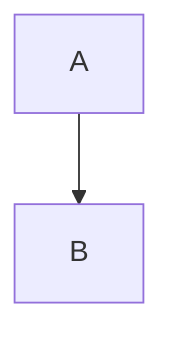

# 1. 概述

普通文字，**粗体**和*斜体*~~，删除~~`，代码 a<b`[，链接](https://example.com/a?b=1)

文字块的子块被提成兄弟

## 1.1 列表

- 无序一
  - 嵌套
- 无序二

1. 有序一
2. 有序二

- [x] 已完成
- [ ] 未完成

# 2. 其他

````go
fmt.Println("```")
````

> 引用里的话

> 高亮块

---

| 表头A | 表头B |
| --- | --- |
| a\|b | 第一行<br>第二行 |

左栏

右栏

\[图片：架构图.png\]

\[内嵌电子表格，未读取\]

同步块内容


